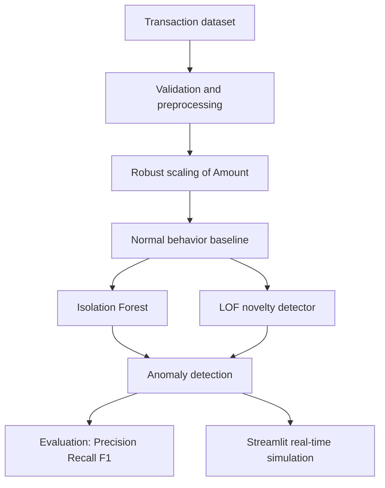

# Real-Time Anomaly Detection in Financial Transactions Using Machine Learning

## Abstract
This project is an educational prototype for flagging unusual credit-card transactions with Isolation Forest and Local Outlier Factor (LOF). It learns a baseline from normal records only and reserves `Class` labels for offline evaluation.

## Problem Statement and Motivation
Credit-card fraud is rare relative to legitimate activity, making the dataset severely imbalanced. A model that labels every record normal can have high accuracy while detecting no fraud, so accuracy is not the principal metric. Labels can also arrive late and fraud patterns change. Unsupervised anomaly detection is useful because it learns a representation of normal behaviour and flags deviations for investigation.

## Technical Background
Isolation Forest creates random feature splits; anomalous points tend to require fewer splits to isolate. Local Outlier Factor (LOF) is density based: a point is unusual when its local density is lower than that of nearby points. RobustScaler transforms `Amount` (and `Time`) using median and interquartile range, reducing sensitivity to extreme financial values.

## Methodology
The loader validates the Kaggle Credit Card Fraud Detection schema. Duplicate records are removed; missing required values cause a clear error. A stratified 60%/20%/20% train/validation/test split is made before preprocessing. RobustScaler is fit on normal training rows only and scales `Time` and `Amount`; its median/IQR scaling is less distorted by extreme transaction amounts. The PCA-like `V1` to `V28` fields are not transformed again for modeling. A separate two-component PCA projection is used only to visualize detected anomalies.

Models fit on normal training transactions, avoiding label leakage. Isolation Forest isolates uncommon observations with random partitions. LOF compares local density with its neighbors and uses novelty mode so it can score new transactions. Candidate score thresholds are selected by maximizing validation F1 and the selected configuration is reported once on the untouched test partition; a real bank would additionally choose based on false-alarm and missed-fraud costs.

## Evaluation
Accuracy is inappropriate for this imbalanced data. The generated `model_comparison.csv` reports precision, recall, F1, false-positive/negative rates, and TP/TN/FP/FN. Precision is the fraction of alerted transactions that are fraud; recall is the fraction of fraud found; F1 balances both. Precision-recall and two model-specific confusion-matrix plots are created during execution. No metrics are stated here because they must be calculated on the supplied dataset.

## Threshold Tuning and Real-Time Simulation
Candidate baseline outlier fractions from 0.001 to 0.05 are tested on validation data. For each candidate, the system derives a score threshold from normal training scores and records precision, recall, F1, and false-positive rate. The threshold with maximum validation F1 is saved; the untouched test data is used only for final reporting. The Streamlit interface loads the saved Isolation Forest, RobustScaler, and selected threshold to calculate a score for one entered transaction. It is a demonstration aid, not a production banking decision service.

## Architecture

## Limitations and Future Scope
This is not production fraud infrastructure: score thresholds, concept drift, feedback loops, security, latency, and business-cost calibration need additional work. Future work can add time-based splits, monitoring, human-review feedback, and cost-sensitive operating thresholds.

## References
- Dal Pozzolo et al., *Calibrating Probability with Undersampling for Unbalanced Classification*, IEEE Symposium Series on Computational Intelligence, 2015 (dataset context).
- Liu, Ting and Zhou, *Isolation Forest*, ICDM 2008.
- Breunig et al., *LOF: Identifying Density-Based Local Outliers*, SIGMOD 2000.
